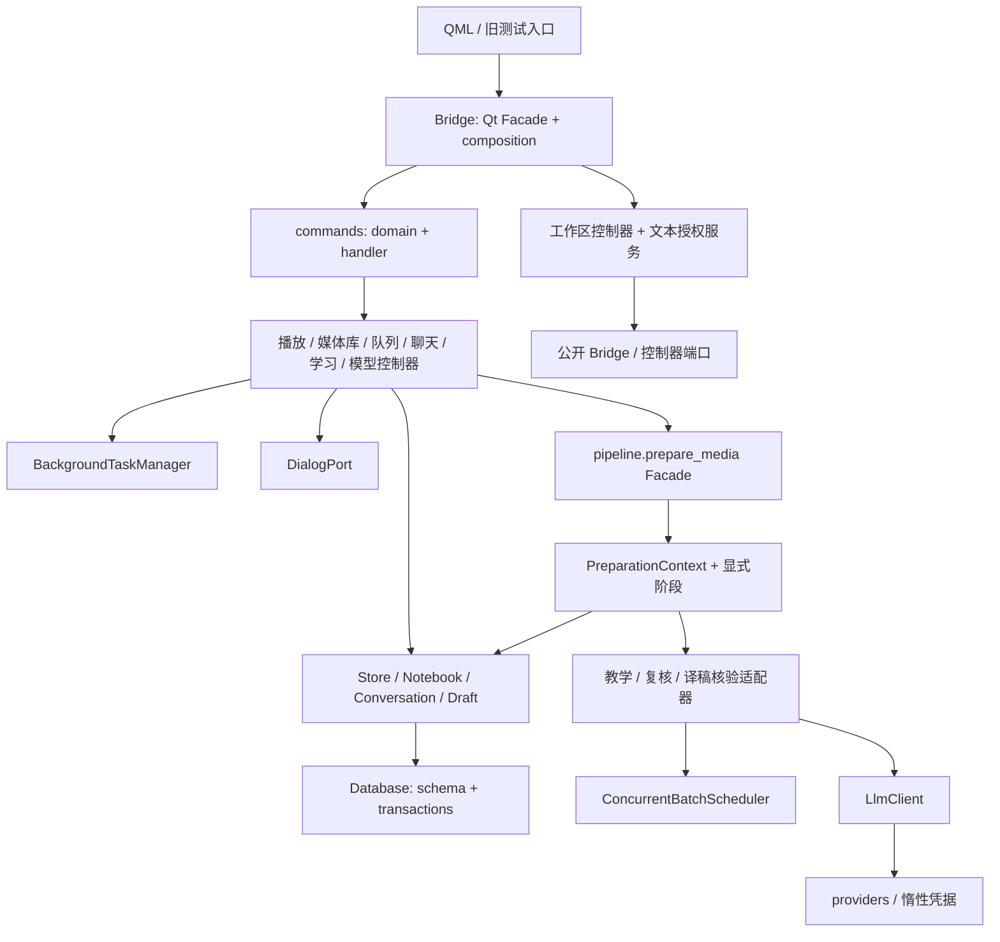

# 状态与架构重构：Step 0 / Phase 3 / Phase 4

本报告接续 [Phase 1 / 2](refactor-phase1-2.md)，工作分支为 `refactor/state-management-phase1-2`。执行顺序为 Step 0 → Phase 3 → Phase 4，每阶段完整离线验证后才开始下一阶段。所有测试使用仓库内隔离数据，禁止外部真实模型请求；原媒体和旧 QWidget 路径不在改动范围。

## 2026-11-24：架构验收后的提交前收尾

Phase 3/4 已通过最终架构验收。本次仅按审阅要求微调三处边界，没有扩大重构、提交/推送或重建便携包：

- `LearningPanel.qml` 的 cache/remove/flush 草稿函数返回真实布尔结果；`Main.qml.flushAllDrafts()` 统一守卫关闭、菜单收起与切区。写入或删除失败保留输入、窗口和 learning 错误，停止去抖定时器。`SystemTray.quitApplication()` 遇窗口拒绝关闭时复位退出标志，既不隐藏图标也不退出应用。
- `Bridge._export_destination()` 的命名与覆盖确认都通过注入的 `native_dialogs`，保留文件名限制及 `QMessageBox.Yes` 兼容比较。
- `quick/main.py` 在打开新会话前同步确认旧窗口草稿已落盘；失败抛出明确错误。`switch_summary` 仅在新会话和目录选择都成功后清空，创建失败或选择回滚时保留。

最小新增回归位于 `test_draft_exit_guards.py`、`test_export_dialog_ports.py`、`test_switch_draft_rollback.py`，覆盖真实 QML 草稿写入/删除失败、托盘退出与菜单收起拦截、注入弹窗命名/覆盖、切区失败与成功提交顺序。既有测试未修改。

本轮新增 16 项用例，最终完整回归 **962 passed、113 subtests passed、0 skipped**。检查原文（`.cache/qa/state-refactor/final-polish/`）：

```text
uv lock --check --offline
Resolved 68 packages in 0.80ms

.venv\Scripts\python.exe -m ruff check .
All checks passed!

.venv\Scripts\python.exe .github/run_offline_tests.py -q --require-ffmpeg
962 passed, 1 warning, 113 subtests passed in 133.71s (0:02:13)

git diff --check
（无输出，退出码 0）
```

Windows 真窗口专项另通过 **20 passed in 11.67s**（`QT_QPA_PLATFORM=windows`，仍使用离线入口和 `--require-ffmpeg`），日志为 `.cache/qa/state-refactor/final-polish-windows.txt`。唯一全量警告仍是既有 wordseg/pkg_resources 弃用提示。用户于 2026-11-24 确认此收尾版本通过，授权提交并合并主分支。

## Step 0：审阅问题收口

| 审阅项 | 实现与边界 | 回归证据 |
| --- | --- | --- |
| 1. 草稿异常恢复 | `quick/bridge.py` 在初始化迁移、布局保存、草稿读取时捕获 `OSError / ValueError / sqlite3.Error`。迁移事务失败保留布局和原草稿；错误经脱敏日志及 learning/notification 域报告。布局先原子写入成功再更新内存；读取失败返回空快照。 | `test_step0_state_safety.py`：坏结构、已有草稿冲突、SQLite 触发器导致中途失败、三类注入异常，以及布局原子写入失败。 |
| 2. 命令分域与状态保持 | `Bridge.command()` 不再无条件清空状态文案；`quick/state.py` 校正真实命令归属。播放、音轨、字幕轨、媒体勾选和复制操作保留后台状态文案，错误落入对应域。 | `test_step0_state_safety.py`：轻量操作保持底栏文案、独立错误不串域、clearChat 与实际媒体命令。 |
| 3. QML 热路径与拷贝 | `chatState.activePhase/activeStatus` 和 `queueState.totalCount/jobCount/hasPending/failedCount/runningMediaPaths` 提供轻量摘要。QML 不订阅完整兼容列表；修订弹窗只在打开且有 ID 时查单条，关闭清除追踪。Markdown 缓存和列表模型只复制变化行，公开快照仍深度独立。 | `test_step0_qml_hotpaths.py`：实际 QML 流式/播放全量 getter 读取计数为零；150 条历史、12 次更新只产生 24 次行拷贝；单条追踪生命周期。 |
| 4. 单宿主弹窗 | `Main.qml` 菜单、设置、子窗口入口统一经 `openDialog()`，每次明确设置 ModelManager 的 transientParent。 | `test_model_manager_reparents_main_menu_after_detached_origin_is_hidden`：从浮动聊天窗打开、停靠隐藏、再从主菜单打开时父窗口恢复为 Main。 |
| 5. 缓存失效与草稿去抖 | 重置、导入、单句修订及任务终态在刷新前失效对应媒体摘要；导入完成使用发起时媒体路径。句备注草稿去抖 350 ms，切句、收藏、关闭（含收起托盘）立即 flush；收藏失败保留草稿和输入。 | `test_step0_events.py`：目标媒体、去重及调用顺序、导航后的导入；`test_step0_qml_hotpaths.py`：去抖、切句、保存、关闭和失败保留。 |
| 6. 事件细节 | 工作区切换接受 `complete` 与 `completed`；同步 `_refresh_jobs()` 消费挂起的单次定时器。 | `test_persisted_completion_aliases_allow_deferred_workspace_switch`、`test_explicit_queue_refresh_consumes_pending_timer`。 |

原有草稿测试仅增加等待去抖落盘的同步条件，保留所有原断言。其余既有测试未删减或降级。

Step 0 首次完整运行：`865 passed, 1 failed, 113 subtests passed`；失败为已有 `test_hub_download_reports_real_file_bytes_and_network_bytes` 取消子进程后的 Windows 临时文件占用（WinError 32），该源文件本阶段未修改。单独执行整个 `test_task_progress.py`：`3 passed in 3.98s`。保留首次证据并重新完整验证，最终结果见下方阶段记录。

Windows 真窗口专项：`16 passed in 12.24s`，覆盖新 QML 热路径、稳定列表与单实例弹窗；使用 `QT_QPA_PLATFORM=windows` 和 `--require-ffmpeg`。

最终完整验证（`.cache/qa/state-refactor/step0-final/`）：

```text
uv lock --check --offline
Resolved 68 packages in 1ms

python -m ruff check .
All checks passed!

python .github/run_offline_tests.py -q --require-ffmpeg
866 passed, 1 warning, 113 subtests passed in 168.43s (0:02:48)

git diff --check
（无输出，退出码 0）
```

跳过 0 项；唯一警告为既有 wordseg/pkg_resources 弃用提示。

## Phase 3：传输、调度和准备阶段

| 模块 | 职责与设计取舍 |
| --- | --- |
| `llm_client.py` | 独立 `LlmClient` 持有配置、请求、流式请求、结构化补全降级及响应元数据。`fork()` 冻结嵌套配置并重置请求统计；凭据继续在实际请求时惰性解析。 |
| `agent.py`、`review.py` | `LearningAgent` 与 `TranscriptReviewer` 组合客户端，共享小型 `TextBatchTask` 配置脚手架；复核器不再继承或实例化 `LearningAgent`。批次构造、校验和教学/复核提示词仍由各领域负责。 |
| `companion.py`、`notebooks.py` | 正常调用公开的 transport / completion 端口；不再为发请求创建教学 Agent。旧私有 hook 仅由 `llm_compat.py` 和 `LegacyCompletionAdapter` 显式适配，保留存量 monkeypatch 扩展点。 |
| `batch_scheduler.py` | 三阶段共用 `ConcurrentBatchScheduler`：并发提交、取消/限流停止、已发请求 drain、部分成功合并、失败 ID 修复、二分拆分、源序 checkpoint、落盘失败后最终一次重试和统一元数据。`RepairPolicy` 显式区分内容错误与传输错误。 |
| `translation_verifier.py` | 译稿核验适配同一调度器；`pipeline._verify_document()` 仅委托，不再维护独立线程池循环。 |
| `unicode_words.py` | 纯 Python Unicode 单词边界；后端导入不再要求 PySide6，已有读音/本地分词行为由回归约束。 |
| `preparation.py`、`pipeline.py` | `PreparationPlan` / `PreparationContext` 承载请求私有状态。公开 `prepare_media()` 依次调用 `plan_preparation → resolve_models → acquire_transcript → run_review_stage → run_teaching_stage → run_verification_stage → publish_document`。失败 checkpoint、异常身份与 JSON 格式保留；设置在入口复制。 |
| `preparation_stages.py`、`material_reset.py` | 集中阶段代码、展示标签和文档/任务重置规则；重置返回独立副本，保留原始句 ID/文字/声学时码。`batch.py` 持久化 `stage_code`，旧任务仍可回退展示。 |
| `workspace_models.py`、`media_inbox.py` | `ModelReadiness(ready, code, message)` 成为就绪判定；保留 `model_status()` 文本包装，收件箱不再解析中文前缀。 |

调度器不拥有教学提示词或存储路径；各阶段只提供分批、执行、校验、结果键和发布回调。每批次新建 worker，复制可变业务字段并 fork 客户端，不再使用 `copy.copy(agent)`。复核文案使用显式阶段标签，不再对教学进度字符串做替换。

完整验证（`.cache/qa/state-refactor/phase3/`）：

```text
uv lock --check --offline
Resolved 68 packages in 1ms

python -m ruff check .
All checks passed!

python .github/run_offline_tests.py -q --require-ffmpeg
904 passed, 1 warning, 113 subtests passed in 164.91s (0:02:44)

git diff --check
（无输出，退出码 0）
```

跳过 0 项；警告同 Step 0。

## Phase 4：组合控制器与数据库边界

`Bridge` 只继承 `QObject`。它声明 Qt 属性/信号/槽、组合服务、汇总状态并保留旧入口。领域控制器持有自己的状态对象，通过有限的 typed ports 访问其他服务；没有以 `__getattr__` 转发整个 Bridge 的万能代理，也没有新的业务 Mixin。

| 模块（均位于 `src/tingmu/quick/`，另有说明除外） | 所有权与边界 |
| --- | --- |
| `tasks.py` | `BackgroundTaskManager` 统一任务互斥、取消事件、完成/进度、`workersChanged`、finishing worker 追踪与执行池生命周期。关闭时停止新任务、取消排队工作并等待后台结束，再关闭数据库。 |
| `playback_controller.py` | 播放器与字幕时间轴、断点、循环、音轨/字幕轨、显示字幕与截帧。 |
| `library_controller.py` | 媒体目录、后台摘要读取、收件箱扫描和自动入队；继续使用 `LibrarySummaryCache` 和代次检查。 |
| `queue_controller.py` | 队列订阅、增量投影、启停/重试/重置；统一重置后的摘要失效、文档重载和界面刷新。Agent 的重做路径也调用同一发布函数。 |
| `chat_controller.py`、`chat_messages.py` | 会话与消息状态、上下文冻结、流式状态机、重试/编辑、修订提交。原会话和当前可见会话分离；工作线程只处理请求快照。 |
| `collections_controller.py`、`learning_controller.py` | 收藏/词态索引、句备注、冻结修订目标与笔记本同步、整理、复习。收藏核心可用纯 Python 测试端口独立验证。 |
| `model_controller.py`、`settings_controller.py` | 安装级模型 CRUD/分配、发现与工作区偏好校验；授权仍属于工作区，配置副本在后台开始前冻结。 |
| `commands.py`、`ui_actions.py` | UI 命令注册表声明 domain、clears_status、handler，是 `state.command_domain()` 的唯一来源。Agent 操作另有封闭分发器与既有 schema 验证，不从 UI 表生成工具。 |
| `dialogs.py`、`application_controller.py` | `DialogPort` / `QtDialogs` 隔离原生文件/输入/确认对话框；应用目录、关于、诊断命令由独立服务处理。 |
| `feature_state.py`、`feature_services.py`、`controller_state.py` | 组合根与有限兼容映射。只有绑定层了解旧私有成员名字，控制器不持有 Bridge 或穿透几十个私有属性。 |
| `workspace_controller.py`、`workspace_text.py`、`workspace_actions.py` | 工作区切换、文本授权和受限操作；改走公开设置快照、任务、聊天、刷新和媒体端口。可信工作区 UI 动作用独立的 12 项不可变注册表分发。文本配置为组合服务。`quick/main.py` 显式接收 `switch_summary`，删除动态桥属性传值。 |
| `tingmu/app_actions.py` | 学习操作用不可变名称→处理函数注册表分发；原权限、参数、版本/全文读取、取消及备份检查保留在原执行边界。 |
| `tingmu/database.py` | 统一 15 张表、3 个索引、`user_version` 0→1 幂等迁移、WAL 和事务连接入口。迁移在跨进程锁及立即事务内执行；失败回滚表、数据和版本。 |
| `tingmu/storage.py`、`notebooks.py`、`conversations.py`、`drafts.py` | Store 持有 Database，三个管理器复用它；`DraftStorage(path)` 保留旧构造。聊天会话、旧投影、迁移标记原子提交，UI 不再执行 SQL。 |

数据库连接采用有界线程归属租约（默认最多 8 个），嵌套操作使用同一连接和 savepoint，`Database.session()` 在一组短事务间复用连接。最外层事务/会话结束即关闭句柄，避免存量便携测试及 Windows 文件移动被空闲连接阻塞；没有为追求复用而引入永久驻留连接。`portable_paths.py` 的只读备份源/目标连接是刻意保留的独立备份端口。



拆分前，工作区模块穿透 Bridge 私有属性，Bridge/Mixin 承载所有 UI 业务；教学 Agent 同时是其他业务的传输器，管道复制调度循环，四个存储类各自建表。拆分后，调用方向为外部 Facade → 领域端口 → 后端服务，准备阶段不反向导入 pipeline，数据库不依赖 UI，纯后端不依赖 Qt。

### 代码行数

统计为 UTF-8 文件物理行数；“拆分前”取 Step 0 全绿后的实际快照，避免把已验收 Phase 1/2 的改动混入本轮收益。

| 文件 | Phase 3 前 | Phase 3 后 | Phase 4 后 |
| --- | ---: | ---: | ---: |
| `quick/bridge.py` | 1854 | 1858 | 1120 |
| `quick/features.py` | 904 | 903 | 3 |
| `agent.py` | 1295 | 1077 | 1077 |
| `pipeline.py` | 691 | 78 | 78 |

Bridge + features 从 2758 行降到 1123 行（约减少 59%）。新模块增加了显式端口和兼容适配，整个仓库总代码量并非同比减少。Bridge 初始化约 299 行负责 Qt 组件和组合装配；`ChatController._v4_send_chat()` 仍是较长的领域编排方法，未宣称已将全部长函数拆成小函数。

## 保留的兼容层及移除条件

| 兼容入口 | 当前实现 | 未来移除条件 |
| --- | --- | --- |
| `Bridge.state/messages/jobs` 与原 QML 信号/槽 | 原接口继续存在；QML 使用分域状态与增量模型，Python 返回隔离快照。 | 所有旧 QML/嵌入调用方迁移后才可移除 list/全局状态投影。 |
| `Bridge._settings/_workers/_callbacks/_closed/_messages/_active_session_id` 等 | 有限字段代理指向领域状态；旧白盒测试可继续写入原字段。生产工作区调用已换成公开快照与任务接口。 | 所有旧测试/扩展改用公开端口，独立兼容版本完成验证。 |
| `Bridge.queue` 替换、`quick.bridge.word_key` hook | 队列端口动态取得当前实例；收藏控制器注入词态键函数，保留原位置的调用计数/替换 hook。 | 所有调用者迁移领域端口前保留，不改变旧回归断言。 |
| `_set_state/_start_job/_job_progress/_job_completed/_feature_command/_v4_send_chat/_perform_app_action/_start_action_jobs` 等 | 显式薄委托，关键回调通过 Facade 端口保留实例 monkeypatch 行为；完整名单见 `feature_services.FEATURE_METHODS` 及 Bridge 声明。 | 存量扩展不再挂接私有 hook 后分批删除；不可立即删除。 |
| `quick.features.FeatureMixin/message/learning_tools` | 旧路径仅 re-export，Bridge 不继承 Mixin；兼容未绑定方法调用的有限适配不参与新架构状态共享。 | 旧 import 和未绑定扩展迁移完毕。 |
| `AppSettings` 旧直接字段保存 | Phase 1/2 的字段增量基线保留，`replace()` 不丢失；序列化不包含内部基线。 | 旧调用者全部使用显式角色 API 后删除增量写适配。 |
| `LearningAgent` 私有传输方法、`batch_worker()`、`PartialBatchResult` | 薄客户端委托/显式 hook 适配；worker 使用独立可变状态，不再浅复制。 | 扩展统一注入公开 LlmClient 后删除 `llm_compat` 和旧 hook。 |
| `TranscriptReviewer` 构造、review、统计和修复字段 | 保留公开签名和属性；共享通用 TextBatchTask 配置脚手架，不继承 LearningAgent。 | 按常规版本化接口处理，不因内部重构删除。 |
| `pipeline.prepare_media/_review_document/_verify_document` 与可替换后端符号 | 保留原签名、异常及调用时依赖注入；实际阶段在 preparation.py。 | 公开 prepare_media 长期保留；私有测试 hook 在消费者迁移后移除。 |
| `model_status()`、无 stage_code 的旧任务 | 文本包装与兼容展示回退；新流程使用结构化就绪和阶段代码。 | 所有历史任务迁移完成后才可移除旧展示回退。 |
| `workspace_api_actions.py`、`workspace_text.py` 旧路径 | 动作实现移入 quick；旧路径保留 re-export / 纯模型辅助函数。`TextSetupMixin` 保留为惰性创建 TextSetupService 的有限适配，兼容原方法、`text_proposal` 和 `_text_bindings`；当前工作区控制器不继承它。 | 外部 import/旧宿主迁移后删除适配与 re-export；纯后端辅助函数可继续保留。 |
| `Store._connection()`、`DraftStorage(db_path)`、ConversationStore.save 两参数 hook | 委托统一 Database；`save_with_legacy()` 在外层事务内按位置调用旧 save，保持观测 hook。 | 所有仓储消费者迁移公开事务/持久化端口后再移除。 |
| `ui/app.py`、`ui/workspace.py` | 没有修改；新模块无依赖。 | 单独兼容退役决策，本轮不处理。 |

## 回归测试与旧测试变更说明

Step 0 的完整新增测试位于 `test_step0_state_safety.py`、`test_step0_events.py`、`test_step0_qml_hotpaths.py`。关键用例包含 `test_bridge_starts_with_failed_legacy_drafts_and_keeps_recovery_data`、`test_lightweight_commands_keep_ongoing_status_and_unrelated_errors`、`test_real_qml_stream_and_playback_never_read_full_compatibility_lists`、`test_model_manager_reparents_main_menu_after_detached_origin_is_hidden`、`test_companion_drafts_debounce_flush_on_switch_collection_and_close` 和 `test_explicit_queue_refresh_consumes_pending_timer`。

| 新增文件（`tests/`） | 关键用例与覆盖 |
| --- | --- |
| `test_llm_client.py` | `test_profile_secret_stays_lazy_through_construction_config_and_fork`、`test_complete_format_fallback_preserves_exact_schema_input_and_identity`、`test_complete_never_downgrades_unrelated_errors`、`test_companion_uses_public_client_without_constructing_learning_agent`、`test_transport_review_and_unicode_helpers_import_without_qt`；涵盖凭据、配置隔离、格式降级、真实模型统计和无 Qt 导入。 |
| `test_batch_scheduler.py` | `test_shared_scheduler_repairs_only_invalid_rows_after_cumulative_checkpoint`、`test_shared_repair_policy_bounds_partial_singletons_and_splits_identity_errors`、`test_fatal_provider_error_stops_submission_and_drains_success_in_source_order`、`test_checkpoint_failure_drains_and_final_retry_keeps_original_failure`、`test_unexpected_worker_or_accounting_error_still_drains_valid_results`、`test_worker_fork_isolates_nested_configuration_metadata_and_preserves_explicit_hooks`、`test_translation_checkpoint_failure_preserves_both_paid_results_and_retries_cumulatively`。原有 `test_agent_concurrency.py::test_cancel_during_translation_persists_running_calls_only` 继续约束取消后的已完成批次。 |
| `test_preparation_boundaries.py`、`test_preparation_stages.py` | `test_local_pipeline_freezes_settings_and_persists_stage_codes_with_raw_sources`、`test_explicit_context_cancellation_stops_before_backend_or_storage`、`test_queue_stage_code_is_authoritative_even_when_label_means_another_stage`、`test_model_readiness_returns_typed_status_without_downloads`、`test_store_teaching_reset_still_keeps_personal_entries_and_backup`；补测初始 checkpoint 失败、局部分词失败后的原始材料保留。 |
| `test_database.py` | 空库统一 schema；`test_version_zero_upgrade_preserves_live_archived_and_draft_data_and_is_idempotent`；迁移失败全回滚；新版拒绝降级；嵌套 savepoint；有界租约和关闭等待；多 Store 并发；闲置数据库目录移动/关闭后删除；`test_chat_legacy_projection_and_marker_are_one_atomic_transaction` 与两参数兼容 hook。 |
| `test_controller_tasks.py` | `test_task_manager_enforces_duplicate_and_material_exclusion_and_cancellation`、`test_shutdown_cancels_pending_pool_work_before_closing_store`、`test_native_file_dialog_is_injected_and_updates_only_selected_library`、领域状态代理与队列替换、设置校验及模型发现快照。 |
| `test_collections_controller.py` | 纯端口下的收藏索引、冻结上下文与幂等、字幕修订源版本/声学时码、备注保存失败保留。 |
| `test_workspace_ports.py` | 仅公开 Bridge 端口的工作区测试、授权绑定原会话、服务动作白名单、人工决策拒绝、`test_session_bootstrap_receives_explicit_summary_without_mutating_origin`，以及可信 UI 注册表的 QML 覆盖、不可变性和任意方法名拒绝；旧 TextSetupMixin 宿主通过组合服务提案/拒绝、兼容属性可读写且拒绝时不写入授权。 |
| `test_command_registry.py` | 真实 QML 命令覆盖和处理器可解析；更改一条注册元数据同时影响域和分发；未知方法名、人工确认和弹窗无法通过 Agent schema 调用。 |
| `test_learning_action_registry.py` | 学习动作注册表与既有 schema 的精确覆盖、不可变白名单、取消及参数验证在分发前执行。 |
| `test_action_reset_publication.py` | Agent all/teaching 重置且 start=False 后活动文档与缓存一致；无关媒体缓存保留；process_videos/manage_queue 仍经过 Bridge 开始任务 hook。 |

旧测试的适配仅涉及同步/夹具：草稿去抖等待；`test_media_inbox.py` 两处 mock 从旧文本状态换成结构化就绪；`test_learning_notes_v5.py` 和 `test_word_recollection.py` 在模拟旧数据库时先撤销统一初始化后的目标表并设置 `user_version=0`，再构造原历史结构。没有删减测试或降低既有断言。

## Phase 4 最终验证

首次完整回归（`.cache/qa/state-refactor/phase4/`）为 `2 failed, 938 passed, 1 warning, 113 subtests passed in 144.93s (0:02:24)`。定位到两个真实兼容遗漏：`test_automatic_queue_restart_pause_and_removal` 暴露媒体库捕获了被替换前的队列实例；`test_word_cards_lookup_once_per_visible_cue_and_skip_position_ticks` 暴露原模块 word_key hook 未透传。均通过显式动态端口修复，原测试与断言不变；队列替换另补专门回归。此后增加的工作区注册表和替换队列用例一并纳入最终全量。

上述修复后的完整运行（`.cache/qa/state-refactor/phase4-final/`）通过 `945 passed, 1 warning, 113 subtests passed in 150.69s (0:02:30)`。随后在兼容清单核对中补回旧 TextSetupMixin 导入适配及测试，最终工作树另跑一轮完整验证，结果见下方。

最终完整验证（`.cache/qa/state-refactor/phase4-complete/`）：

```text
uv lock --check --offline
Resolved 68 packages in 0.93ms

python -m ruff check .
All checks passed!

python .github/run_offline_tests.py -q --require-ffmpeg
946 passed, 1 warning, 113 subtests passed in 135.80s (0:02:15)

git diff --check
（无输出，退出码 0）
```

全部 946 项测试通过，113 项子测试通过，失败 0、跳过 0；唯一警告为既有 wordseg/pkg_resources 弃用提示。FFmpeg 与 ffprobe 均在 PATH，所有阶段使用 `--require-ffmpeg`；测试入口阻断外部网络，仅允许本地 fixture 服务。各阶段使用仓库 `.cache/test-runtime`、`.cache/test-data` 和仓库内临时目录。

Windows 真窗口专项使用 `QT_QPA_PLATFORM=windows`、软件 Qt Quick 后端及 `--require-ffmpeg`，实际创建顶层窗口：

```text
python .github/run_offline_tests.py -q --require-ffmpeg tests/test_step0_qml_hotpaths.py tests/test_incremental_models.py tests/test_ui_state_phase1.py tests/test_qml_workspace.py tests/test_conversation_setup_ui.py tests/test_qml_v5.py tests/test_workspace_ports.py
............................................................             [100%]
60 passed in 34.70s
```

覆盖浮动/全屏弹窗的单宿主和父窗口、停靠隐藏后从菜单重新打开、草稿 flush、稳定列表委托状态、字幕拖动、词态热路径和工作区会话切换；零跳过。证据为 `.cache/qa/state-refactor/phase4-windows.txt`。此后新增的旧 Python 导入适配不参与当前 QML 控制器继承或窗口行为。

## 范围与后续维护

- 本轮只更改仓库源代码、测试及文档；没有提交/推送、重新打包或改动已安装 EXE，没有访问真实收费模型服务，也没有操作外部媒体。
- Stage/metadata 仍保留历史 JSON 字段以保证向前/向后兼容，新增类型只在内部统一含义；没有将所有旧字典一次性改成新的持久化格式。
- 聊天流式编排仍有较长领域方法，Bridge 组合初始化也较长；后续可在不改变冻结上下文与事件顺序的前提下继续细分。
- 取消是协作式的。无法强制中断正在第三方传输中阻塞的 Python 线程；关闭会先取消并等待，必要时由收尾线程等剩余请求退出后关闭 Store，防止后台访问已关闭数据库。
- 数据库只在显式 session/嵌套事务范围复用连接；这是便携移动、零空闲文件锁与连接开销之间的明确取舍。
- 保留的私有兼容 hook 与旧任务文本展示回退有明确清单；后续删除需要独立兼容迁移，不能直接移除白盒测试。

Step 0、Phase 3、Phase 4 均已完成并通过阶段验证，停在最终架构审阅点。
